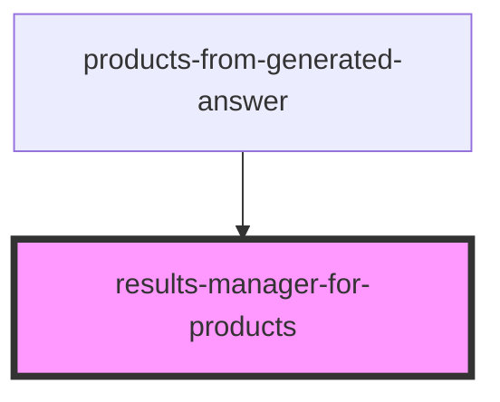

# results-manager-for-products

<!-- Auto Generated Below -->

## Overview

Component used to manage results & result templates.
See https://docs.coveo.com/en/atomic/latest/usage/create-a-result-list/

## Dependencies

### Used by

 - products-from-generated-answer

### Graph

----------------------------------------------

*Built with [StencilJS](https://stenciljs.com/)*
